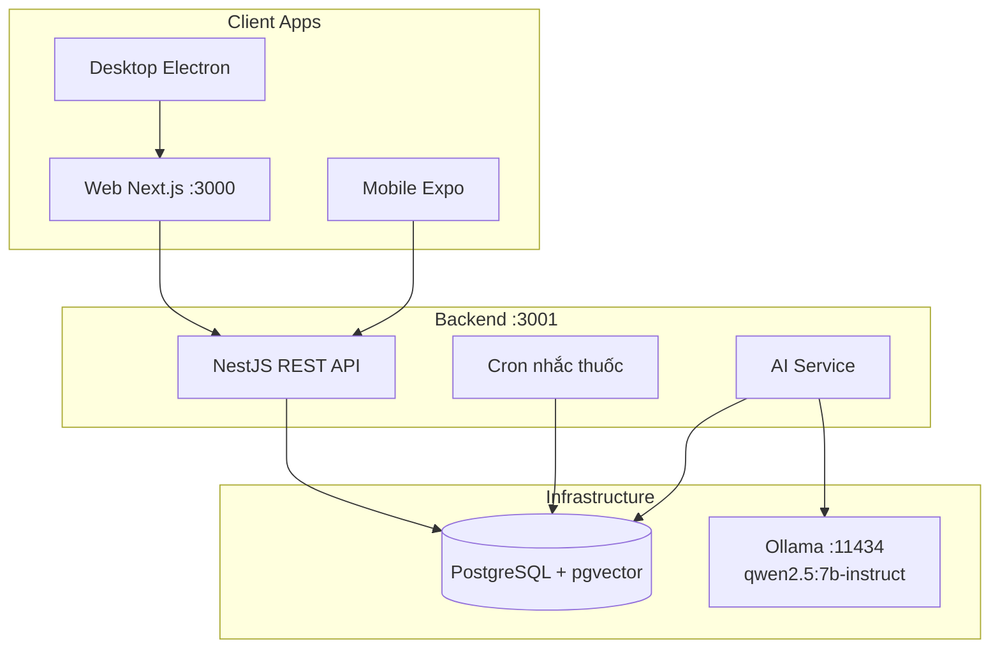

<p align="center">
  
</p>

<p align="center">
  <strong>Quản lý sức khỏe cá nhân — AI chạy local trên máy bạn, không cần API key ngoài</strong>
</p>

<p align="center">
  
  
  
  
  
</p>

---

## Mục lục

- [Giới thiệu](#giới-thiệu)
- [Bắt đầu nhanh](#bắt-đầu-nhanh)
- [Chạy hàng ngày](#chạy-hàng-ngày)
- [AI Health Assistant](#ai-health-assistant)
- [Tính năng](#tính-năng)
- [Kiến trúc](#kiến-trúc)
- [Lệnh thường dùng](#lệnh-thường-dùng)
- [Xử lý sự cố](#xử-lý-sự-cố)
- [FAQ](#faq)
- [Tài liệu thêm](#tài-liệu-thêm)

---

## Giới thiệu

**HealthGuard** giúp bạn theo dõi sức khỏe hàng ngày tại một nơi: ghi triệu chứng, đo chỉ số, nhắc uống thuốc, nhận cảnh báo và trò chuyện với **AI tư vấn sức khỏe chạy hoàn toàn trên máy của bạn** — dữ liệu không gửi lên cloud AI.

| Nền tảng | Vai trò |
|----------|---------|
| **Web** (Next.js) | Dashboard chính — trình duyệt / PWA |
| **Desktop** (Electron) | App Windows — thông báo native |
| **Mobile** (Expo) | App điện thoại — đồng bộ cùng tài khoản |
| **Backend** (NestJS) | API + AI + cron nhắc thuốc |
| **Ollama + PostgreSQL** | LLM local + lưu trữ dữ liệu |

> **Lưu ý y khoa:** Thông tin chỉ mang tính tham khảo, **không thay thế tư vấn bác sĩ chuyên khoa**.

---

## Bắt đầu nhanh

Mọi lệnh chạy trong **PowerShell**, tại **thư mục gốc** repo (có `package.json`, `backend/`, `frontend/`).

### Yêu cầu

| Cần có | Kiểm tra | Ghi chú |
|--------|----------|---------|
| Node.js ≥ 20 | `node -v` | [nodejs.org](https://nodejs.org) LTS |
| Docker Desktop | Icon cá voi **xanh** ở khay hệ thống | Postgres + Ollama chạy trong Docker |
| RAM ≥ 8 GB | — | Khuyến nghị 16 GB cho AI `7b` |
| Ổ trống ≥ 8 GB | — | Model AI ~4.7 GB |
| Internet | Chỉ **lần đầu** | Tải Docker images + model Ollama |

### Lần đầu trên máy (chỉ 1 lần)

```powershell
# 1. Bật Docker Desktop, đợi icon xanh

# 2. Cài thư viện
cd backend  ; npm install ; cd ..
cd frontend ; npm install ; cd ..

# 3. Setup: env + Postgres + seed demo + pull model AI
npm run setup:ai

# 4. Kiểm tra (Backend/Frontend DOWN lúc này là bình thường)
npm run doctor
```

Khi `setup:ai` thành công, bạn sẽ thấy:

```
Ollama ready.
  Chat model : qwen2.5:7b-instruct
  Embed model: nomic-embed-text
```

### Chạy app

Mở **2 terminal** tại thư mục gốc:

```powershell
# Terminal 1 — API + Postgres + Ollama
npm run dev:backend

# Terminal 2 — Web dashboard
npm run dev:frontend
```

Mở trình duyệt: **[http://localhost:3000](http://localhost:3000)**

| | |
|--|--|
| Email | `demo@healthguard.vn` |
| Mật khẩu | `Demo@123` |

---

## Chạy hàng ngày

Docker Desktop phải đang chạy. **Không** chạy lại `setup:ai` trừ khi máy mới / reset DB.

```
Terminal 1                    Terminal 2
npm run dev:backend    →      npm run dev:frontend
       ↓                              ↓
  :3001 API                    :3000 Web
       \___________________________/
                    ↓
           http://localhost:3000
```

| Cổng | Dịch vụ |
|------|---------|
| 3000 | Web app |
| 3001 | API · [Swagger](http://localhost:3001/api/docs) · [Health](http://localhost:3001/api/health) |
| 11434 | Ollama (LLM local) |
| 5432 | PostgreSQL (Docker) |

**Lưu ý:** Chỉ chạy **một** `dev:backend` tại một thời điểm. Nếu thấy `EADDRINUSE port 3001`, đóng terminal backend cũ trước khi chạy lại.

---

## AI Health Assistant

HealthGuard dùng **một model duy nhất** để tập trung và tối ưu:

| Thành phần | Giá trị |
|------------|---------|
| Chat model | `qwen2.5:7b-instruct` |
| Embedding (RAG) | `nomic-embed-text` |
| Provider | Ollama local — **không cần API key** |
| Timeout | 120 giây (lần đầu có thể chậm ~30–60s) |

### AI làm gì?

- **Phân tích triệu chứng** — phân tầng khẩn cấp, gợi ý chẩn đoán phân biệt, chuyên khoa
- **Chat tư vấn** — trả lời theo cấu trúc y khoa: Nhận định → Khả năng → Cần làm → Khi nào đi khám
- **Sàng lọc dấu hiệu đỏ** — đau ngực, đột quỵ, khó thở nặng → khuyên gọi 115
- **RAG** — tra cứu kiến thức y tế nội bộ qua pgvector

### Kiểm tra AI đang dùng model nào

```powershell
Invoke-RestMethod http://localhost:3001/api/health | ConvertTo-Json -Depth 4
```

Kết quả mong đợi:

```json
{
  "status": "ok",
  "ai": {
    "provider": "ollama",
    "model": "qwen2.5:7b-instruct",
    "ollama": "ok",
    "fallback": "none"
  }
}
```

Nếu `fallback: "mock"` hoặc câu trả lời kiểu *"Triệu chứng ... mức 5/10 được phân tầng"* → Ollama chưa phản hồi kịp. Xem [Xử lý sự cố](#xử-lý-sự-cố).

### Cấu hình AI (`backend/.env`)

```env
AI_PROVIDER=ollama
OLLAMA_MODEL=qwen2.5:7b-instruct
OLLAMA_MODEL_CANDIDATES=qwen2.5:7b-instruct
OLLAMA_EMBED_MODEL=nomic-embed-text
OLLAMA_TIMEOUT_MS=120000
```

---

## Tính năng

### Theo dõi sức khỏe

| Trang | Mô tả |
|-------|-------|
| **Chỉ số** | Huyết áp, đường huyết, cân nặng, nhịp tim, nhiệt độ, SpO2 + biểu đồ |
| **Triệu chứng** | Ghi nhận mức 1–10, mẫu nhanh, nhập giọng nói |
| **Thuốc** | Lịch uống, cron nhắc tự động, % tuân thủ |
| **Nhật ký** | Timeline toàn bộ hoạt động |
| **Cảnh báo** | Phát hiện chỉ số bất thường + thông báo trình duyệt |
| **Mục tiêu tuần** | Theo dõi tiến độ trên Dashboard |

### AI & phân tích

| Trang | Mô tả |
|-------|-------|
| **Phân tích AI** | Gửi triệu chứng → mức khẩn cấp + chẩn đoán phân biệt + chuyên khoa |
| **AI Chat** | Hỏi đáp sức khỏe, nhớ ngữ cảnh hội thoại |
| **Báo cáo** | Tóm tắt sức khỏe 7 ngày |

### Hồ sơ & bảo mật

- Dị ứng, bệnh nền, nhóm máu, liên hệ khẩn cấp
- Đổi mật khẩu, xuất dữ liệu JSON
- JWT auth — secrets chỉ ở backend

### Lộ trình người dùng mới

1. **Hồ sơ** → điền thông tin y tế (AI dùng để tư vấn chính xác hơn)
2. **Chỉ số / Triệu chứng / Thuốc** → ghi nhận hàng ngày
3. **Phân tích AI / Chat** → hỏi đáp, nhận gợi ý
4. **Cảnh báo** → theo dõi thông báo tự động

---

## Kiến trúc



```
healthguard/
├── backend/      # API NestJS + Prisma + AI + clinical triage
├── frontend/     # Web dashboard Next.js 15
├── desktop/      # Electron shell (Windows)
├── mobile/       # Expo React Native
├── ml/           # Fine-tune pipeline (tùy chọn)
├── scripts/      # CLI & PowerShell helpers (Windows)
├── brand/        # Logo và icon
└── docs/         # Tài liệu kỹ thuật
```

Luồng AI:

```
Câu hỏi người dùng
    → Clinical triage (rule-based sàng lọc dấu hiệu đỏ)
    → RAG (pgvector + keyword fallback)
    → Ollama qwen2.5:7b-instruct (trả lời có cấu trúc)
    → Fallback rule-based (chỉ khi Ollama timeout/lỗi)
```

---

## Lệnh thường dùng

Tất cả lệnh từ **thư mục gốc**:

| Lệnh | Việc làm |
|------|----------|
| `npm run doctor` | Chẩn đoán env, Docker, model, API |
| `npm run status` | Trạng thái 3 dịch vụ (live) |
| `npm run urls` | In địa chỉ web/API/Swagger |
| `npm run setup:ai` | Setup lần đầu: env + DB + seed + pull model |
| `npm run dev:backend` | Start Postgres + Ollama + migrate + API |
| `npm run dev:frontend` | Start web dashboard |
| `npm run dev:ollama` | Chỉ start Ollama + pull model nếu thiếu |
| `npm run dev:desktop` | Electron app |
| `npm run dev:mobile` | Expo app |
| `npm run dev:all` | Mở 4 terminal cùng lúc |
| `npm run env` | In `.env` (đã che secret) |
| `npm run hg` / `help` | Menu CLI đầy đủ |

Kiểm thử:

```powershell
cd backend
npm run test:unit    # không cần Docker
npm run test:e2e     # cần PostgreSQL đang chạy
```

---

## Xử lý sự cố

Chạy `npm run doctor` trước — script gợi ý bước tiếp theo.

| Triệu chứng | Nguyên nhân | Cách xử lý |
|-------------|-------------|------------|
| `EADDRINUSE port 3001` | Backend đã chạy ở terminal khác | Đóng terminal backend cũ, chỉ giữ 1 instance |
| AI trả lời kiểu *"Triệu chứng ... mức 5/10"* | Ollama timeout → fallback rule-based | Đợi model load xong (~60s lần đầu), hỏi lại |
| `"ollama": "down"` trong health | Container Ollama chưa chạy | `npm run dev:ollama` |
| `"ollama": "no_model"` | Model chưa pull | `npm run dev:ollama` hoặc `docker compose exec -T ollama ollama pull qwen2.5:7b-instruct` |
| Docker lỗi | Docker Desktop chưa chạy | Mở Docker Desktop, đợi icon xanh |
| PostgreSQL not ready | Container chưa healthy | `cd backend` → `docker compose logs postgres` |
| Frontend lỗi MIME / hydration | Cache `.next` cũ | `npm run dev:frontend` (tự xóa cache) |
| AI trả lời chậm 30–60s | Model `7b` load lần đầu trên CPU/GPU | Bình thường — lần sau nhanh hơn |

### Xem model Ollama đang có

```powershell
cd backend
docker compose exec -T ollama ollama list
```

Kết quả mong đợi:

```
NAME                       SIZE
qwen2.5:7b-instruct        4.7 GB
nomic-embed-text:latest    274 MB
```

---

## FAQ

<details>
<summary><strong>Có cần internet để dùng không?</strong></summary>

- **Lần đầu:** Cần internet tải Docker images + model Ollama (~5 GB).
- **Sau đó:** AI, database, app chạy offline trên máy bạn.
</details>

<details>
<summary><strong>Tại sao AI trả lời chậm hoặc trả lời tệ?</strong></summary>

Model `qwen2.5:7b-instruct` chạy local trên CPU/GPU máy bạn. Lần đầu hỏi có thể mất 30–60 giây do model đang load vào RAM. Nếu Ollama timeout, app rơi về fallback rule-based (câu trả lời máy móc) — hỏi lại sau khi model đã sẵn sàng.

Kiểm tra: `Invoke-RestMethod http://localhost:3001/api/health` → `"ollama": "ok"`, `"fallback": "none"`.
</details>

<details>
<summary><strong>Máy yếu có chạy được không?</strong></summary>

Tối thiểu 8 GB RAM. Khuyến nghị 16 GB + GPU (ví dụ RTX 3050 4GB) cho trải nghiệm mượt với model `7b`. Không dùng model lớn hơn (`14b`) trên máy ≤16 GB RAM.
</details>

<details>
<summary><strong>Chạy trên Mac / Linux được không?</strong></summary>

Backend + frontend chạy được. Script PowerShell trong `scripts/` tối ưu cho **Windows**. Trên Mac/Linux: `docker compose up -d` trong `backend/` và `npm run dev` trong từng app.
</details>

<details>
<summary><strong>Test trên điện thoại thật?</strong></summary>

1. Máy tính và điện thoại cùng Wi-Fi.
2. Sửa `mobile/.env`: `EXPO_PUBLIC_API_URL=http://<IP-máy-tính>:3001/api`
3. `npm run dev:mobile` → quét QR bằng Expo Go.
</details>

<details>
<summary><strong>Dữ liệu lưu ở đâu?</strong></summary>

PostgreSQL trong Docker volume. Xuất backup: **Hồ sơ → Tải JSON** hoặc `GET /api/users/me/export`.
</details>

---

## Tài liệu thêm

| Tài liệu | Nội dung |
|----------|----------|
| [docs/ARCHITECTURE.md](docs/ARCHITECTURE.md) | Kiến trúc chi tiết |
| [docs/SECURITY.md](docs/SECURITY.md) | Bảo mật và phân tách secrets |
| [docs/DEPLOY.md](docs/DEPLOY.md) | Deploy production |
| [docs/qa-checklist.md](docs/qa-checklist.md) | QA và kịch bản demo 5 phút |
| [backend/README.md](backend/README.md) | API và biến môi trường |
| [ml/README.md](ml/README.md) | Fine-tune model (tùy chọn) |

---

<p align="center">
  <sub>HealthGuard — Theo dõi sức khỏe thông minh. AI trên máy bạn. Dữ liệu thuộc về bạn.</sub>
</p>

<p align="center">
  <sub>Thông tin chỉ mang tính tham khảo, không thay thế tư vấn y khoa chuyên nghiệp.</sub>
</p>
