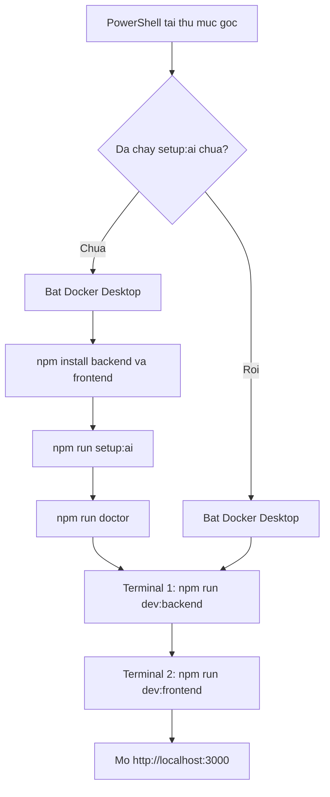
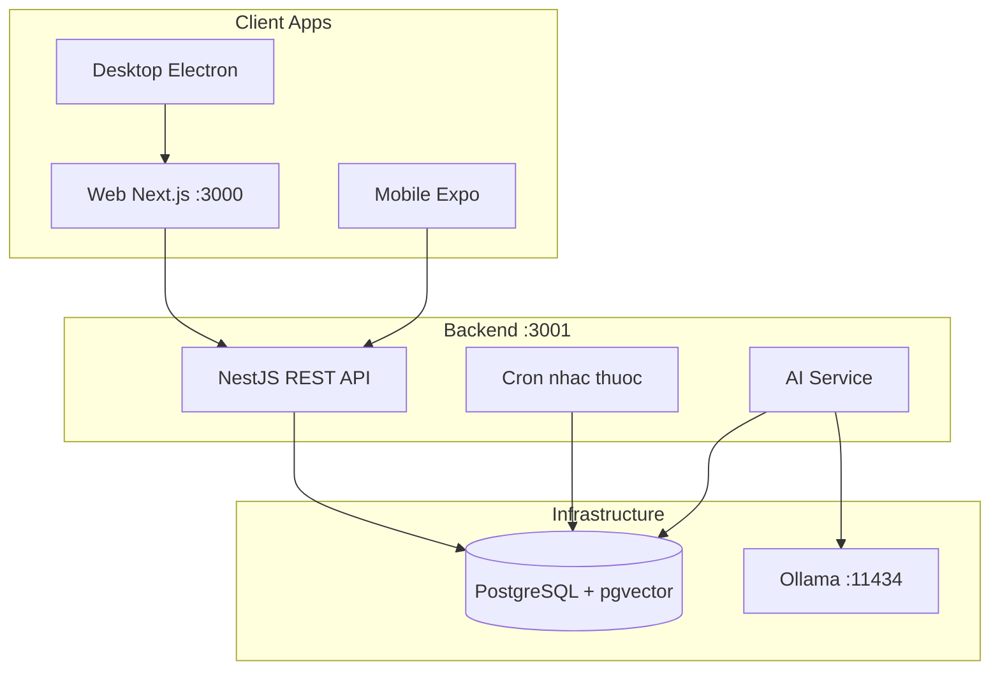

<p align="center">
  
</p>

<p align="center">
  <strong>Hệ thống quản lý sức khỏe cá nhân — AI chạy local, không cần API key ngoài</strong>
</p>

<p align="center">
  
  
  
  
  
</p>

---

## Mục lục

- [HealthGuard là gì?](#healthguard-là-gì)
- [Cách chạy source](#cách-chạy-source)
- [Hướng dẫn sử dụng (người dùng)](#hướng-dẫn-sử-dụng-người-dùng)
- [Kiến trúc hệ thống](#kiến-trúc-hệ-thống)
- [Lệnh thường dùng](#lệnh-thường-dùng)
- [Địa chỉ và tài khoản demo](#địa-chỉ-và-tài-khoản-demo)
- [Tính năng](#tính-năng)
- [Xử lý sự cố](#xử-lý-sự-cố)
- [FAQ](#faq)
- [Kiểm thử](#kiểm-thử)
- [Tài liệu thêm](#tài-liệu-thêm)

---

## HealthGuard là gì?

HealthGuard giúp bạn **theo dõi sức khỏe hàng ngày** tại một nơi: ghi triệu chứng, đo chỉ số, nhắc uống thuốc, nhận cảnh báo và trò chuyện với **AI tư vấn sức khỏe chạy trên máy của bạn** (Ollama — không gửi dữ liệu lên cloud AI).

| Nền tảng | Vai trò |
|----------|---------|
| **Web** (Next.js) | Dashboard chính — dùng trên trình duyệt / PWA |
| **Desktop** (Electron) | App Windows — thông báo native + system tray |
| **Mobile** (Expo) | App điện thoại — đồng bộ cùng tài khoản |
| **Backend** (NestJS) | API + AI + cron nhắc thuốc |
| **Ollama + PostgreSQL** | AI local + lưu trữ dữ liệu |

> **Lưu ý y khoa:** HealthGuard chỉ mang tính tham khảo, **không thay thế tư vấn bác sĩ chuyên khoa**.

---

## Cách chạy source

Mọi lệnh chạy trong **PowerShell**, tại **thư mục gốc** (có `package.json`, `backend/`, `frontend/`).

```powershell
Get-ChildItem package.json, backend, frontend
```



Sau `setup:ai`, `doctor` báo Backend/Frontend **DOWN là đúng** — chưa start 2 terminal.

### Yêu cầu

| Cần có | Kiểm tra | Nếu thiếu |
|--------|----------|-----------|
| Node.js ≥ 20 | `node -v` | [nodejs.org](https://nodejs.org) (bản LTS) |
| Docker Desktop đang chạy | Icon cá voi **xanh** ở khay hệ thống | [Docker Desktop](https://www.docker.com/products/docker-desktop/) |
| Internet | Chỉ **lần đầu** (tải model AI ~2 GB) | — |
| RAM / ổ trống | ≥ 8 GB RAM, ≥ 5 GB trống | — |

---

### Lần đầu (chỉ 1 lần trên máy này)

**1. Bật Docker Desktop** — đợi icon xanh (~20–60 giây).

**2. Cài thư viện**

```powershell
cd backend  ; npm install ; cd ..
cd frontend ; npm install ; cd ..
```

Cần desktop/mobile thì thêm:

```powershell
cd desktop ; npm install ; cd ..
cd mobile  ; npm install ; cd ..
```

**3. Env + Postgres + seed demo + kéo model Ollama**

```powershell
npm run setup:ai
```

Lệnh này: tạo `.env` từ mẫu, start Postgres (pgvector), migrate + seed `demo@healthguard.vn`, start Ollama, pull `qwen2.5:3b-instruct` và `nomic-embed-text`.

Thành công khi thấy:

```
== AI setup complete ==
Ollama ready.
  Chat model : qwen2.5:3b-instruct
```

**4. Kiểm tra (chưa start web/API)**

```powershell
npm run doctor
```

Doctor in **bảng màu**: file env, Docker, model Ollama (tên + dung lượng), ping `:11434` / `:3001` / `:3000`, JSON `GET /api/health` nếu API đang chạy, rồi **việc cần làm** tiếp theo.

Mong đợi **lúc này** (chưa start web/API):

- Docker **OK**, Ollama **OK** (nếu `setup:ai` đã kéo model)
- Backend `:3001` và Frontend `:3000` **DOWN** — **đúng**
- Dòng việc cần làm: `npm run dev:backend`

`npm run doctor -- --json` in object đầy đủ (tự động hóa / debug).

Nếu Docker hoặc Ollama DOWN → [Xử lý sự cố](#xử-lý-sự-cố).

---

### Hàng ngày (2 terminal)

Docker Desktop phải đang chạy. **Không** chạy lại `setup:ai`.

`npm run dev:backend` tự bật Postgres + Ollama, chạy **migrate** (không seed lại — dữ liệu bạn ghi nhận được giữ nguyên).

```
Terminal 1                          Terminal 2
npm run dev:backend                 npm run dev:frontend
        |                                    |
        v                                    v
HealthGuard API:                    Local: http://localhost:3000
http://localhost:3001/api
        \________________  ________________/
                         v
              http://localhost:3000
```

**Terminal 1**

```powershell
npm run dev:backend
```

Chờ:

```
HealthGuard API: http://localhost:3001/api
Swagger docs: http://localhost:3001/api/docs
```

**Terminal 2** (cửa sổ mới, cùng thư mục gốc)

```powershell
npm run dev:frontend
```

Chờ:

```
▲ Next.js
- Local: http://localhost:3000
```

Giữ **cả hai terminal mở**. Mở [http://localhost:3000](http://localhost:3000):

| | |
|--|--|
| Email | `demo@healthguard.vn` |
| Mật khẩu | `Demo@123` |

Health check: [http://localhost:3001/api/health](http://localhost:3001/api/health)

```json
{ "status": "ok", "database": "ok", "ai": { "provider": "ollama", "ollama": "ok" } }
```

| Cổng | Dịch vụ |
|------|---------|
| 3000 | Web |
| 3001 | API / [Swagger](http://localhost:3001/api/docs) |
| 11434 | Ollama |
| 5432 | PostgreSQL (Docker) |

**Desktop / mobile** (sau khi web đã chạy): `npm run dev:desktop` · `npm run dev:mobile` · hoặc `npm run dev:all`.

---

## Hướng dẫn sử dụng (người dùng)

Sau khi đăng nhập, bạn sẽ thấy **Dashboard**. Lộ trình gợi ý cho người mới:

### Bước 1 — Thiết lập hồ sơ

Vào **Hồ sơ** → điền thông tin y tế (dị ứng, bệnh nền, nhóm máu, liên hệ khẩn cấp). AI Chat dùng thông tin này để tư vấn phù hợp hơn.

### Bước 2 — Ghi nhận sức khỏe hàng ngày

| Trang | Việc cần làm |
|-------|----------------|
| **Chỉ số** | Nhập huyết áp, đường huyết, cân nặng, nhịp tim, nhiệt độ, SpO2 |
| **Triệu chứng** | Mô tả triệu chứng + mức độ 1–10 (có mẫu nhanh và nhập giọng nói) |
| **Thuốc** | Thêm thuốc + giờ uống (`08:00` hoặc `08:00, 20:00`) → đánh dấu **Đã uống** mỗi ngày |

### Bước 3 — Dùng AI và theo dõi

| Trang | Việc cần làm |
|-------|----------------|
| **Phân tích AI** | Gửi triệu chứng → nhận mức độ khẩn cấp + gợi ý chuyên khoa |
| **AI Chat** | Hỏi đáp sức khỏe (nút chat nổi góc phải) |
| **Nhật ký** | Xem toàn bộ hoạt động theo thời gian |
| **Cảnh báo** | Thông báo huyết áp cao, nhắc thuốc, gợi ý AI |

### Bước 4 — Bật thông báo (tùy chọn)

**Hồ sơ → Cài đặt thông báo → Bật thông báo → Thử thông báo**

Trên Chrome mobile: **Cài đặt HealthGuard** để thêm vào màn hình chính (PWA).

### Mẹo nhanh

- Nhập huyết áp **150/95** để thấy cảnh báo tự động.
- Dashboard: **điểm sức khỏe**, **streak**, **mục tiêu tuần** — bấm **+1** khi hoàn thành.
- **Hồ sơ → Tải JSON** để sao lưu dữ liệu.

---

## Kiến trúc hệ thống



```
healthguard/
├── backend/      # API NestJS + Prisma + AI
├── frontend/     # Web dashboard Next.js
├── desktop/      # Electron shell
├── mobile/       # Expo React Native
├── ml/           # Fine-tune Ollama (tùy chọn)
├── scripts/      # Script chạy trên Windows
├── brand/        # Logo và icon
└── docs/         # Tài liệu kỹ thuật
```

---

## Lệnh thường dùng

Tất cả lệnh từ **thư mục gốc**:

| Lệnh | Việc làm | Khi nào |
|------|----------|---------|
| `npm run hg` / `help` | Menu CLI | Xem mọi lệnh |
| `npm run doctor` | Chẩn đoán env, Docker, model, API (bảng + JSON) | Gặp lỗi / trước demo |
| `npm run status` | Bảng live 3 dịch vụ | API đã chạy |
| `npm run env` | In `.env` đã che secret | Kiểm tra cấu hình |
| `npm run urls` | Địa chỉ web/API/Swagger | Copy nhanh |
| `npm run setup:ai` | Env + DB + seed + pull model Ollama | Lần đầu / máy mới |
| `npm run setup:envs` | Sync `.env` từ mẫu | Sau khi đổi `.env.example` |
| `npm run dev:backend` | Start Postgres + Ollama + migrate + API | Mỗi lần dev |
| `npm run dev:frontend` | Web dashboard | Mỗi lần dev |
| `npm run dev:ollama` | Chỉ Ollama + pull model nếu thiếu | Ollama DOWN |
| `npm run dev:desktop` | Electron | Cần desktop |
| `npm run dev:mobile` | Expo | Cần mobile |
| `npm run dev:all` | Mở 4 PowerShell | Demo full stack |
| `npm run train:ai` | Tạo `healthguard-med` + chấm triage | Sau khi Ollama đã có model gốc |
| `npm run brand:assets` | Tạo PNG/ICO logo | Sau khi sửa `brand/` |

---

## Địa chỉ và tài khoản demo

| Dịch vụ | URL |
|---------|-----|
| Web app | [http://localhost:3000](http://localhost:3000) |
| API | [http://localhost:3001/api](http://localhost:3001/api) |
| Swagger | [http://localhost:3001/api/docs](http://localhost:3001/api/docs) |
| Health check | [http://localhost:3001/api/health](http://localhost:3001/api/health) |
| Ollama | [http://localhost:11434](http://localhost:11434) |

```
Email   : demo@healthguard.vn
Mật khẩu: Demo@123
```

Cùng account trên web, desktop, mobile → dữ liệu đồng bộ qua API.

---

## Tính năng

### Theo dõi sức khỏe

| Tính năng | Mô tả ngắn |
|-----------|-------------|
| Chỉ số sinh tồn | Huyết áp, đường huyết, cân nặng, nhịp tim, nhiệt độ, SpO2 + biểu đồ 7/30/90 ngày |
| Triệu chứng | Ghi nhận, mẫu nhanh, nhập giọng nói, xu hướng lặp lại theo vùng cơ thể |
| Nhắc thuốc | Nhiều giờ uống, cron nhắc tự động, ghi nhận uống/bỏ lỡ, % tuân thủ |
| Nhật ký | Timeline thống nhất mọi hoạt động |
| Mục tiêu tuần | Theo dõi tiến độ trên Dashboard |
| Cảnh báo | Tự phát hiện chỉ số bất thường + thông báo trình duyệt |

### AI local (offline)

- **Không cần API key** Gemini/OpenAI
- Model: `qwen2.5:3b-instruct` qua Ollama
- RAG: pgvector + embedding `nomic-embed-text`
- Fallback rule-based khi Ollama chưa sẵn sàng
- Fine-tune tùy chọn: [ml/README.md](ml/README.md)

### Hồ sơ và bảo mật

- Thông tin y tế: dị ứng, bệnh nền, nhóm máu, liên hệ khẩn cấp
- Đổi mật khẩu, xuất dữ liệu JSON
- JWT auth, secrets chỉ ở backend

### Đa nền tảng

| Nền tảng | Thông báo |
|----------|-----------|
| Web / PWA | Browser notification, cài app lên màn hình chính |
| Desktop | Native notification + system tray |
| Mobile | Expo notifications + poll alerts |

---

## Xử lý sự cố

Chạy `npm run doctor` trước — script gợi ý bước tiếp theo.

| Triệu chứng | Nguyên nhân thường gặp | Cách xử lý |
|-------------|------------------------|------------|
| `Docker ... cannot find the file` | Docker Desktop chưa chạy | Mở Docker Desktop, đợi icon xanh, chạy lại `npm run setup:ai` |
| `PostgreSQL not ready` | Container chưa sẵn sàng / port 5432 bận | `cd backend` rồi `docker compose logs postgres` |
| Ollama **DOWN** | Container Ollama chưa chạy | `npm run dev:ollama` |
| AI trả lời kiểu rule-based (mock) | Ollama chưa sẵn sàng hoặc biến shell cũ | `npm run dev:backend` (script xóa `AI_PROVIDER=mock`) |
| Port 3000 / 3001 bận | Process cũ còn chạy | Script tự kill; hoặc đóng terminal cũ |
| Lỗi path Unicode (`Đồ án`) | Windows + Electron | `npm run dev:desktop` (tự map ổ `X:`) |
| Frontend lỗi MIME / static | Cache `.next` cũ | `npm run dev:frontend` (tự xóa cache) |
| `EPERM` khi `prisma generate` | Backend đang chạy, file bị lock | Dừng backend, chạy lại `npx prisma generate` |

Nếu health check có `"ollama": "down"` → `npm run dev:ollama`.

---

## FAQ

<details>
<summary><strong>Có cần internet để dùng không?</strong></summary>

- **Lần đầu:** Cần internet để tải Docker images và model Ollama (~2 GB).
- **Sau đó:** AI, database, app chạy offline trên máy bạn.
</details>

<details>
<summary><strong>Tại sao AI trả lời chậm?</strong></summary>

Model chạy local trên CPU/GPU máy bạn. Lần đầu hỏi có thể mất 30–60 giây. Model `qwen2.5:3b-instruct` cân bằng tốc độ và chất lượng cho máy cá nhân.
</details>

<details>
<summary><strong>Chạy trên Mac / Linux được không?</strong></summary>

Backend + frontend chạy được. Script PowerShell trong `scripts/` tối ưu cho **Windows**. Trên Mac/Linux: `docker compose` trong `backend/` và `npm run dev` trong từng app.
</details>

<details>
<summary><strong>Làm sao test trên điện thoại thật?</strong></summary>

1. Máy tính và điện thoại cùng Wi-Fi.
2. Sửa `mobile/.env`: `EXPO_PUBLIC_API_URL=http://<IP-máy-tính>:3001/api`
3. `npm run dev:mobile` → quét QR bằng Expo Go.
</details>

<details>
<summary><strong>Dữ liệu lưu ở đâu?</strong></summary>

PostgreSQL trong Docker volume. Xuất backup: **Hồ sơ → Tải JSON** hoặc `GET /api/users/me/export`.
</details>

<details>
<summary><strong>Demo 5 phút cho giảng viên?</strong></summary>

Xem [docs/qa-checklist.md](docs/qa-checklist.md) — mục **Demo script (5 phút)**.
</details>

---

## Kiểm thử

```powershell
cd backend
npm run test:unit   # không cần Docker
npm run test:e2e    # cần PostgreSQL đang chạy
```

QA thủ công: [docs/qa-checklist.md](docs/qa-checklist.md)

---

## Tài liệu thêm

| Tài liệu | Nội dung |
|----------|----------|
| [docs/ARCHITECTURE.md](docs/ARCHITECTURE.md) | Kiến trúc chi tiết |
| [docs/SECURITY.md](docs/SECURITY.md) | Bảo mật và phân tách secrets |
| [docs/DEPLOY.md](docs/DEPLOY.md) | Deploy production |
| [docs/qa-checklist.md](docs/qa-checklist.md) | QA và kịch bản demo |
| [ml/README.md](ml/README.md) | Fine-tune model Ollama |
| [backend/README.md](backend/README.md) | API và biến môi trường |

- [backend/AGENTS.md](backend/AGENTS.md)
- [frontend/AGENTS.md](frontend/AGENTS.md)
- [desktop/AGENTS.md](desktop/AGENTS.md)
- [mobile/AGENTS.md](mobile/AGENTS.md)

---

<p align="center">
  <sub>HealthGuard — Theo dõi sức khỏe thông minh, AI trên máy bạn, dữ liệu thuộc về bạn.</sub>
</p>

<p align="center">
  <sub>Thông tin chỉ mang tính tham khảo, không thay thế tư vấn y khoa chuyên nghiệp.</sub>
</p>
