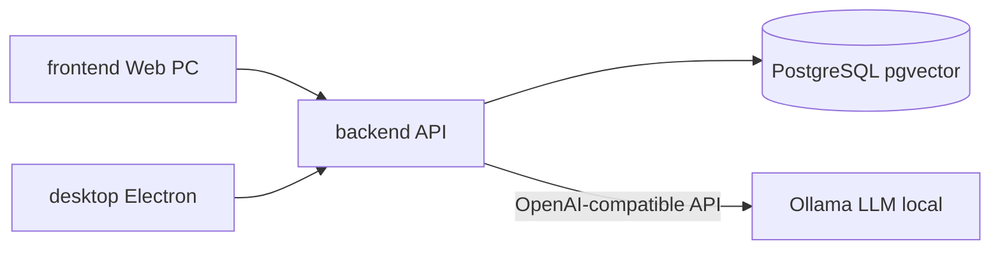

# Kiến trúc HealthGuard


## Tổng quan (Web + app PC + API + AI local)


```

healthguard/

├── backend/     NestJS 11 + Prisma 6 + PostgreSQL + Ollama

├── frontend/    Next.js 15 + Redux Toolkit + RTK Query

├── desktop/     Electron shell

└── docs/        Tài liệu đồ án

```





Mỗi client **standalone** — `npm install && npm run dev` riêng, cùng trỏ API.


## Backend


```

backend/src/

├── main.ts              Swagger, Helmet, CORS, global pipes/filters

├── config/              Env validation

├── common/              Guards, filters, constants

├── modules/health/      GET /api/health (+ Ollama status)

├── ai/

│   ├── local-llm.service.ts   Ollama client

│   ├── rag.service.ts         pgvector + keyword RAG

│   └── ai.service.ts          analyze / chat / insight

├── auth/ users/ symptoms/ vitals/ alerts/ dashboard/ medications/

└── prisma/

```


- Swagger: `/api/docs`

- Docker: `backend/docker-compose.yml` (postgres + ollama + api)


## AI Stack (offline-first)


| Component | Technology |

|-----------|------------|

| LLM inference | Ollama (`qwen2.5:3b-instruct`) |

| Embeddings | Ollama (`nomic-embed-text`) |

| Vector store | pgvector on PostgreSQL |

| Fallback | Rule-based mock (no external deps) |


Không cần `GEMINI_API_KEY` hay `OPENAI_API_KEY`.


## Frontend (Web PC)


```

frontend/src/

├── app/                 App Router

├── store/api/baseApi.ts RTK Query — all endpoints

└── types/

```


Frontend không gọi AI trực tiếp — mọi request qua `/api/ai/*`.


## Kết nối giữa các app


| Client | Env var | Local value |

|--------|---------|-------------|

| Web | `NEXT_PUBLIC_API_URL` | `http://localhost:3001/api` |

| App PC | `FRONTEND_URL` | `http://localhost:3000` |

| Backend | `OLLAMA_BASE_URL` | `http://localhost:11434/v1` |

| Backend | `CORS_ORIGIN` | `http://localhost:3000,http://localhost:8081` |


## Deploy


| App | Platform | Ghi chú |

|-----|----------|---------|

| Backend + DB | Railway / VPS | |

| Ollama | Cùng VPS hoặc GPU server | Đổi `OLLAMA_BASE_URL` |

| Frontend | Vercel | |

| App PC | Electron trên Windows | Mở `FRONTEND_URL` |


Chi tiết: [DEPLOY.md](./DEPLOY.md)


## Agent guidelines


- [backend/AGENTS.md](../backend/AGENTS.md)

- [frontend/AGENTS.md](../frontend/AGENTS.md)

- [desktop/AGENTS.md](../desktop/AGENTS.md)

