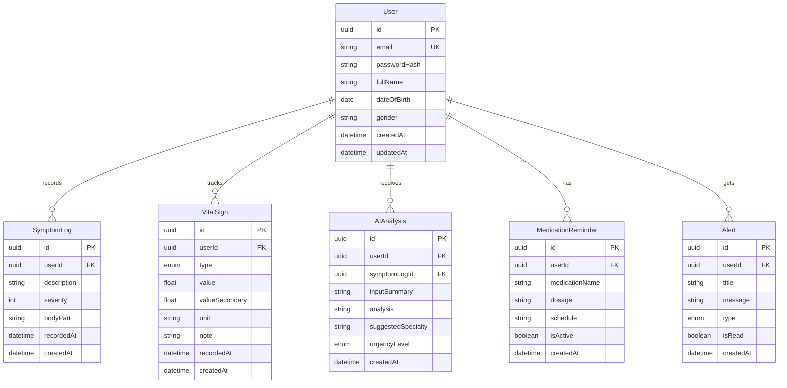

# Database Schema — HealthGuard

## ERD

## VitalSign Types

| Type | Fields | Unit |
|------|--------|------|
| BLOOD_PRESSURE | value (systolic), valueSecondary (diastolic) | mmHg |
| BLOOD_SUGAR | value | mg/dL |
| WEIGHT | value | kg |

## Urgency Levels

- `LOW` — Theo dõi tại nhà
- `MEDIUM` — Nên khám trong vài ngày
- `HIGH` — Cần khám sớm / cấp cứu

## Indexes

- `User.email` — unique
- `SymptomLog.userId, recordedAt` — query history
- `VitalSign.userId, type, recordedAt` — chart data
- `Alert.userId, isRead` — unread alerts
