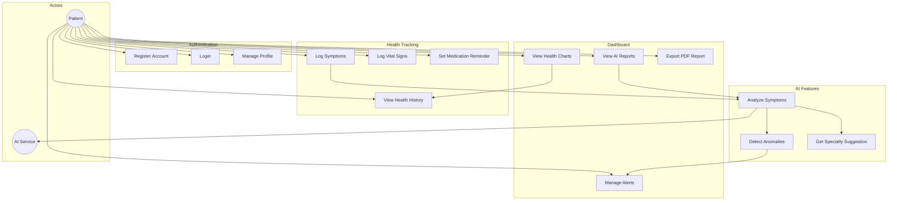

# Use Case Diagram — HealthGuard

## Actors

- **Patient (Người dùng):** Sử dụng mobile app và web dashboard
- **AI Service:** Phân tích triệu chứng, tạo cảnh báo
- **System:** Gửi notification, lưu trữ dữ liệu

## Use Cases

## Use Case Descriptions

| ID | Use Case | Mô tả |
|----|----------|-------|
| UC1 | Register | Tạo tài khoản với email, mật khẩu, thông tin cơ bản |
| UC2 | Login | Xác thực JWT, trả access + refresh token |
| UC4 | Log Symptoms | Nhập mô tả triệu chứng, mức độ, vị trí cơ thể |
| UC5 | Log Vital Signs | Nhập huyết áp, đường huyết, hoặc cân nặng |
| UC8 | Analyze Symptoms | Gửi triệu chứng + lịch sử tới AI, nhận phân tích |
| UC9 | Detect Anomalies | Rule-based kiểm tra chỉ số bất thường |
| UC11 | View Charts | Biểu đồ xu hướng theo thời gian trên dashboard |
| UC14 | Manage Alerts | Xem và đánh dấu đã đọc các cảnh báo |
